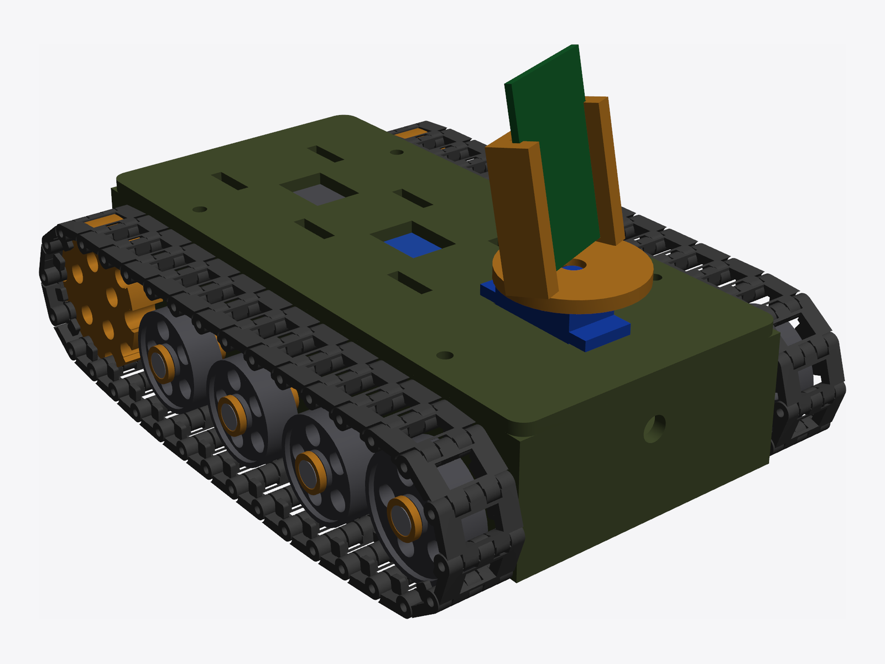
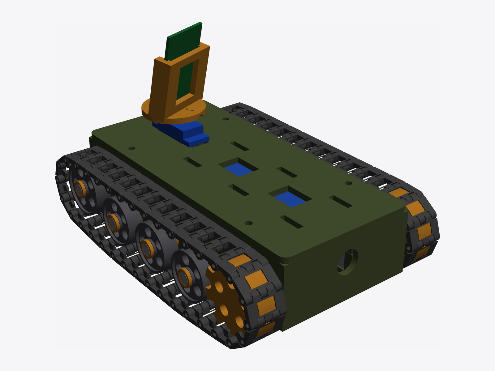
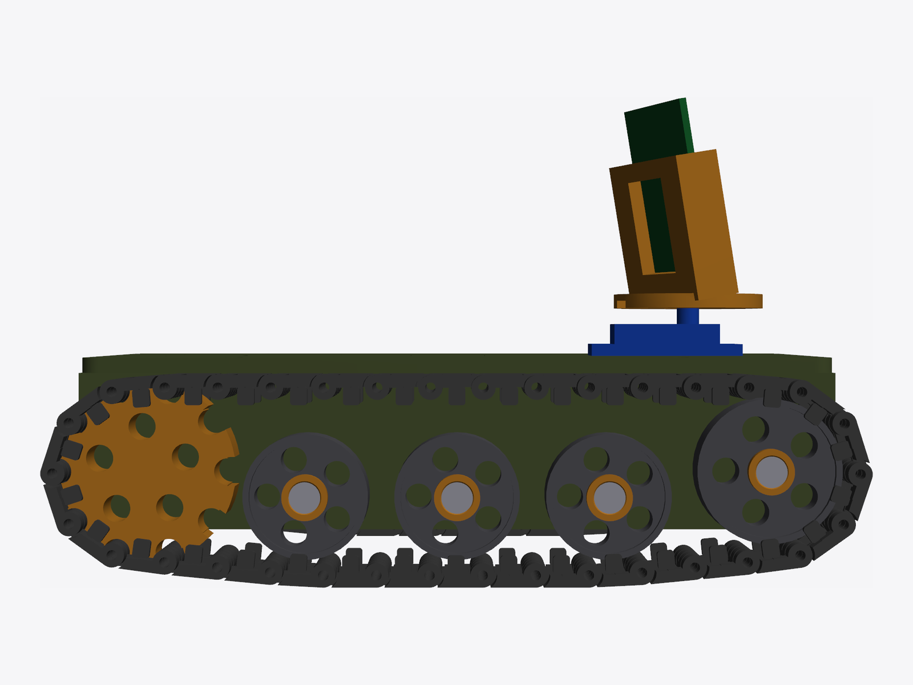
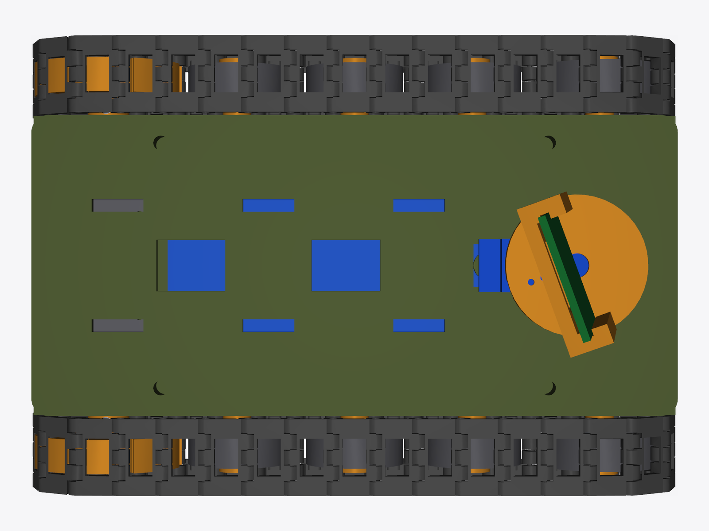
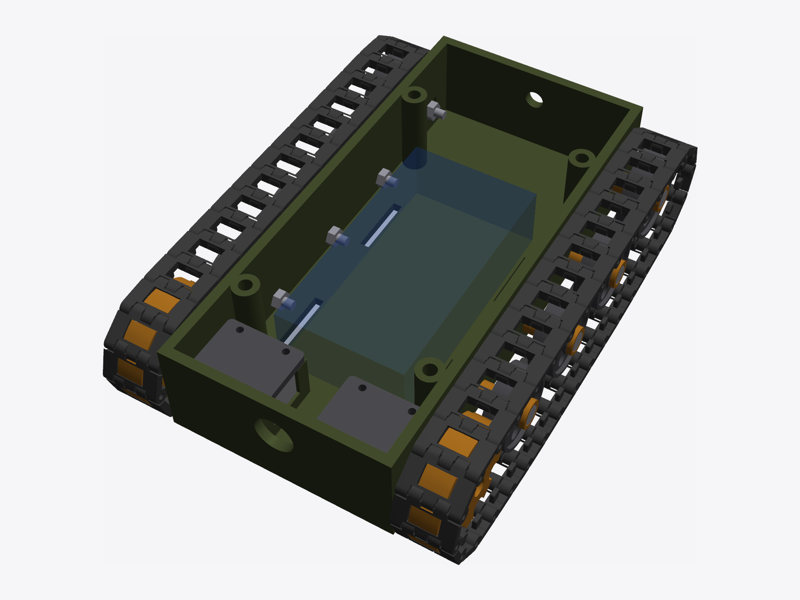
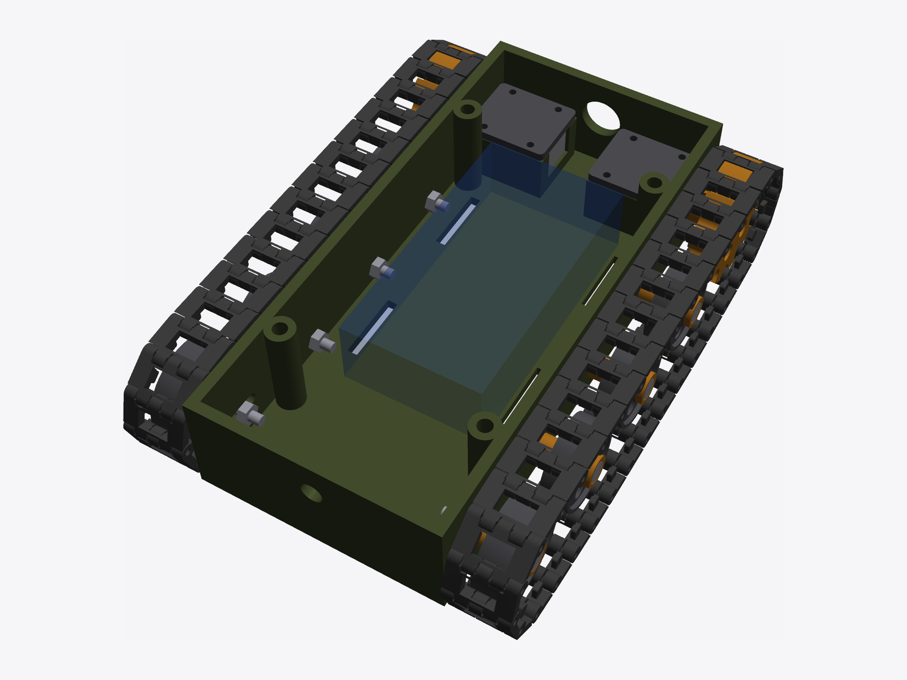
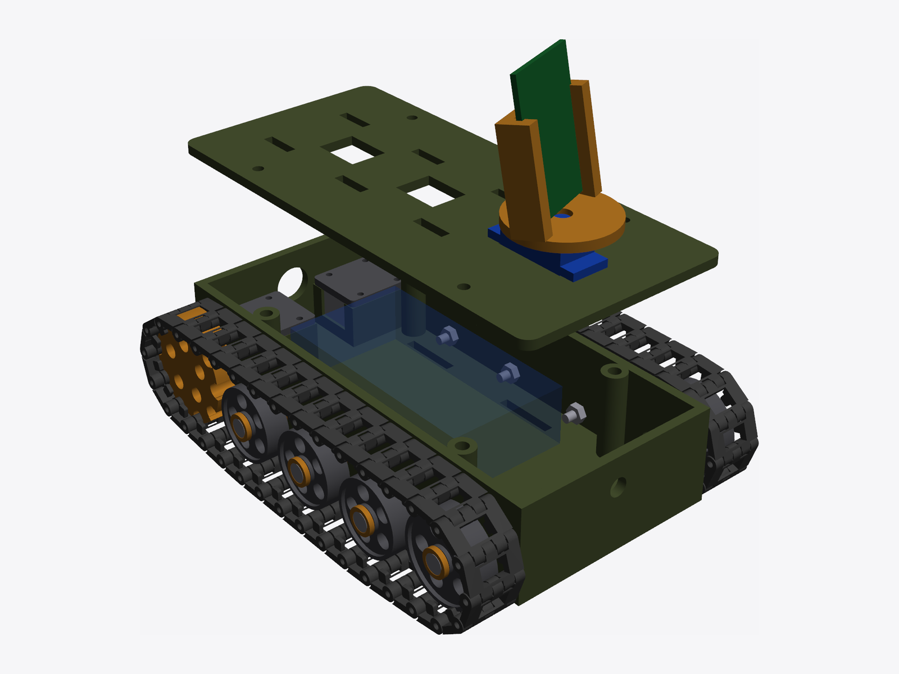
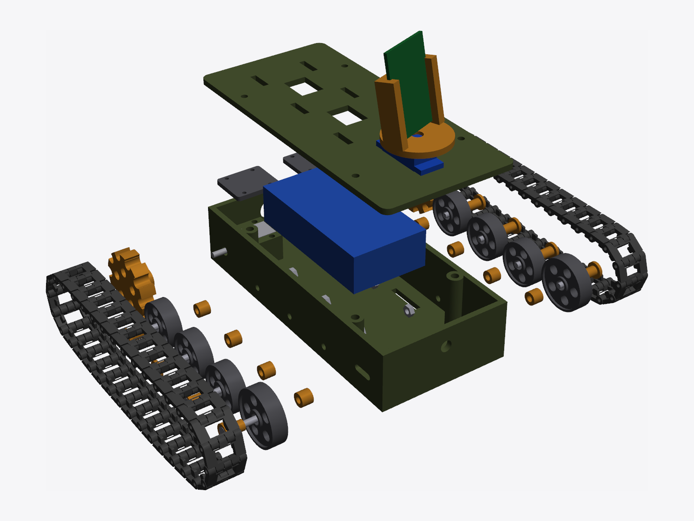
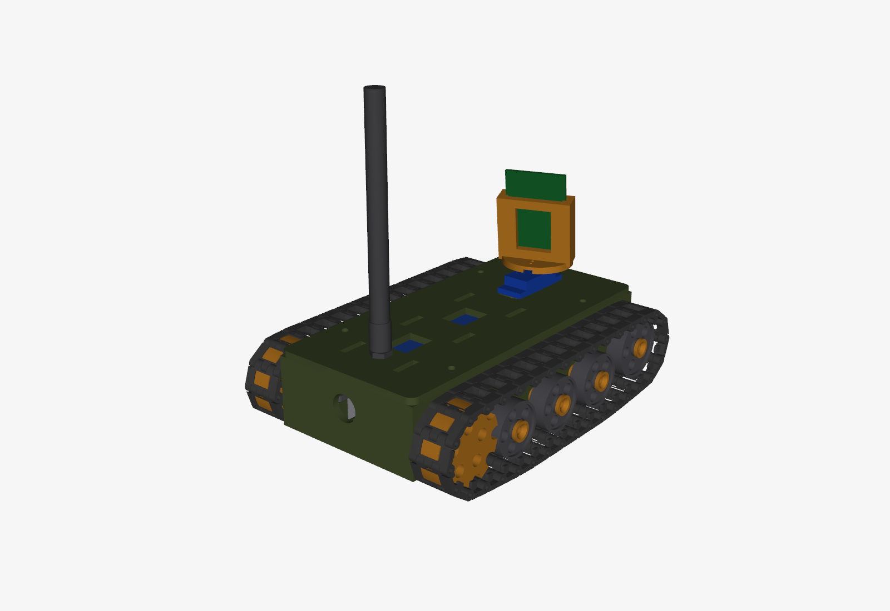

# Mini tank

ESP32-S3 · 2 × N20 · TB6612FNG · pan camera

## Gallery

| | | |
|:---:|:---:|:---:|
|  |  |  |
| *Closed — front left* | *Closed — rear right* | *Closed — side* |
|  |  |  |
| *Closed — top* | *Open — rear* | *Open — front* |
|  |  |  |
| *Deck lifted* | *Exploded* | *With antenna* |
