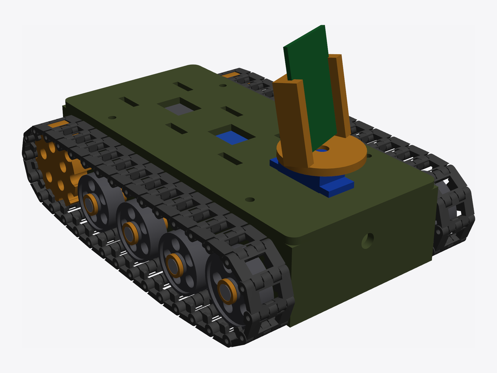
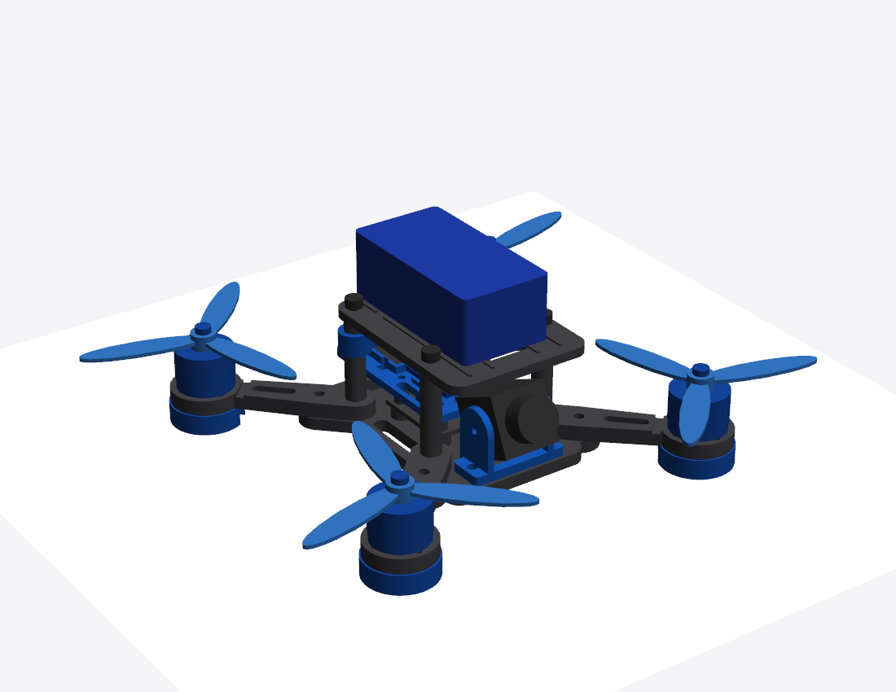
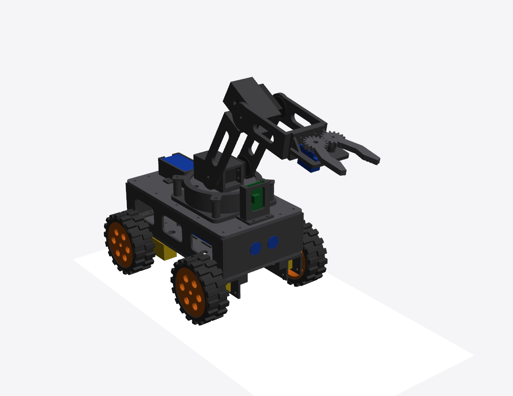

## About
> This repo contains a list of my side projects. Mostly used for project-based-learning. It's not a very organized repo atm, so please bear with me :).

## 3D modeling and printing
- I recently got into 3D printing and I must say I've been having the time of my life! The exact 3D printer is the [Elegoo Centauri 2](https://ca.elegoo.com/products/centauri-2?srsltid=AYCX9vLwMO0g31pQYpYOZUAgQi3nO6X3DkCc7j95zk58nU_1_cWChKkm), a very budget friendly but capable 3D printer. This gives you the opportunity to transform imaginations into real tangible stuff. 
- I've mostly been generating 3D models (STL) with Claude AI, and to my great surprise, it's better than you may realize. Try it out! 
- You can find a list of 3D models I've generated and printed. I'm currently putting together all the electronics and writing the micro-controller programs to breath some life into these toys. 
- Some 3D models:

## Micro-controller projects
1. [Home automation with Raspberry Pi 3B+](rpi/RPI_HOME_AUTO.md)
2. [Arduino automation projects](arduino/README.md)
3. [Car robots](robots/adeept_rasptank/README.md)

## Learning programming languages
1. [Rust](./rust/)
2. [Go](./go/)

- Author: Peterson Yuhala
